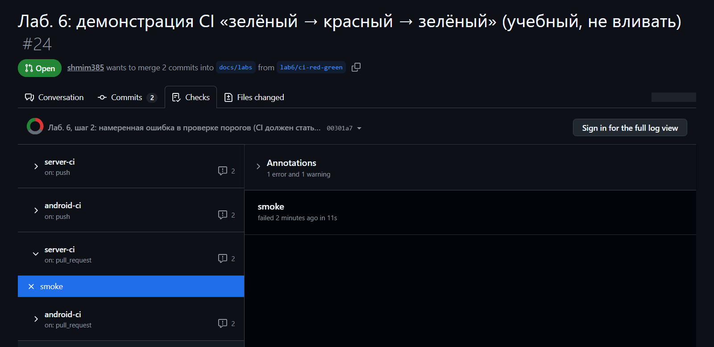
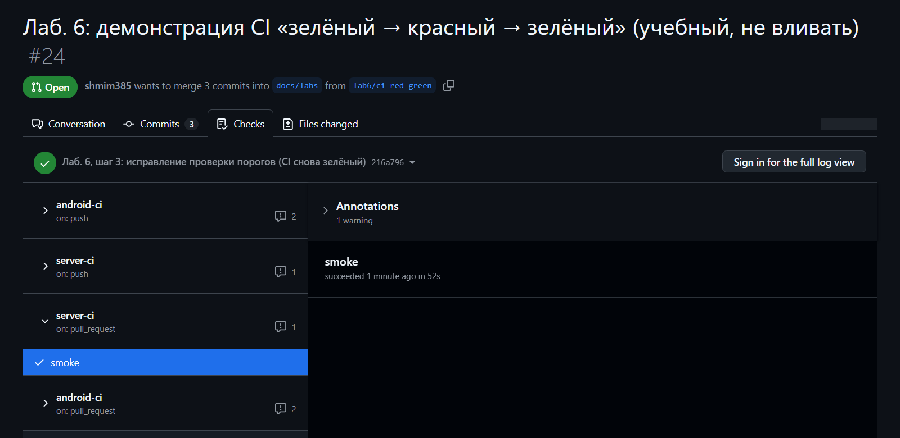

# Подтверждение работы пайплайнов

## Учебный pull request: зелёный → красный → зелёный

Демонстрация проведена 26.11.2026 на pull request
[#24](https://github.com/Helnex/Room-Climate/pull/24) «Лаб. 6: демонстрация CI
«зелёный → красный → зелёный»» из ветки `lab6/ci-red-green` в ветку лабораторных `docs/labs`
(базовая ветка выбрана, чтобы учебные коммиты не попали в `main`; PR закрыт без слияния).

| Шаг | Коммит | Изменение | Результат server-ci |
|---|---|---|---|
| 1 | `c48cac9` | Корректное изменение (комментарий в тесте) | зелёный: все 19 тестов UT, контрактный тест, смоук-тест — успешно |
| 2 | `00301a7` | Намеренная ошибка: в `put_settings` условие `temp_min >= temp_max` заменено на `>` | **красный**: шаг «Unit tests (lab specs)» упал на UT-03, остальные шаги пропущены |
| 3 | `216a796` | Исправление: условие `>=` возвращено | зелёный |


*Рисунок — Шаг 1: server-ci / smoke в PR #24 успешно, коммит отмечен зелёной галочкой.*



*Рисунок — Шаг 2: после коммита с ошибкой server-ci / smoke завершился с ошибкой (красный крест).*

Фрагмент журнала шага «Unit tests (lab specs UT-01…UT-19)» в прогоне шага 2:

```text
Run python3 -m unittest -v test_lab_specs
test_ut01_save_valid_thresholds ... ok
test_ut02_min_greater_than_max_rejected ... ok
test_ut03_equal_min_and_max_rejected ... FAIL
test_ut04_out_of_range_rejected ... ok
...
FAIL: test_ut03_equal_min_and_max_rejected (test_lab_specs.ThresholdsSpecs.test_ut03_equal_min_and_max_rejected)
  File "/home/runner/work/Room-Climate/Room-Climate/roomclimate/server/test_lab_specs.py", line 88, in test_ut03_equal_min_and_max_rejected
    self.assertEqual(r.status_code, 400)
AssertionError: 200 != 400
Ran 19 tests in 0.766s
FAILED (failures=1)
Error: Process completed with exit code 1.
```

Тест сработал так, как задумано: сервер начал принимать равные минимум и максимум
(ответ 200 вместо 400), и CI остановил пайплайн до дорогих шагов сборки Docker.



*Рисунок — Шаг 3: после исправления server-ci снова зелёный.*

Пока защита ветки `main` не включена владельцем репозитория (задача T-37), кнопка слияния
при красном CI остаётся доступной с предупреждением «Some checks were not successful»;
после включения правила из раздела 5 она блокируется.
