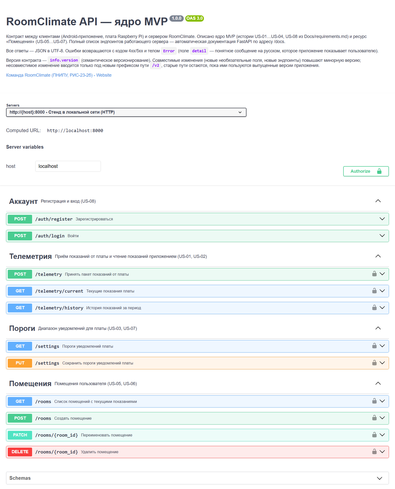
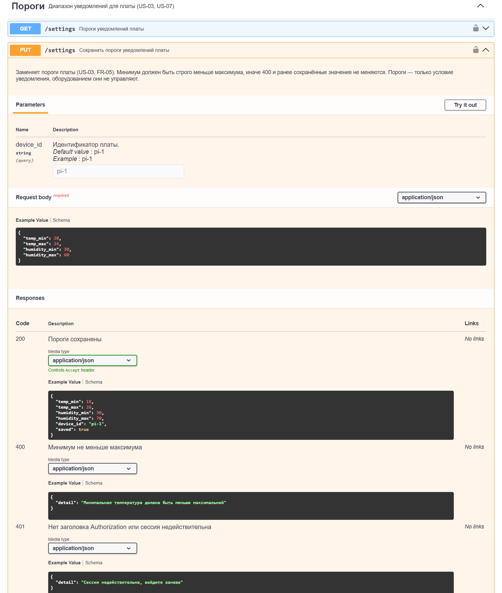

# Контракт API: проектирование и OpenAPI-спецификация

# Сведения о проекте

**Проект:** RoomClimate — система мониторинга климата в помещении.

**Команда (РИС-23-2б):** Кобзев С.И. — разработчик, тимлид; Крючков К.П. — разработчик,
DevOps-инженер, Product Owner; Хабарова А.А. — разработчик, аналитик; Вековшинин И.Н. —
разработчик, Scrum Master; Камалетдинов М.В. — разработчик, тестировщик.

**Репозиторий:** https://github.com/Helnex/Room-Climate. Контракт — `Docs/api/openapi.yaml`,
описание — `Docs/api.md` (ссылки из `README.md`).

# Цель работы

Спроектировать контракт API между модулями проекта методом «контракт-первый», оформить его
как OpenAPI-спецификацию и организовать по нему параллельную работу клиента и сервера.

# Материалы работы

@include Docs/api.md

# Отображение спецификации в Swagger

Спецификация проверена валидатором `openapi-spec-validator` (результат — «valid», OpenAPI
3.0.3) и отображена в Swagger UI 5 — том же движке документации, что и в Swagger Editor.

*Рисунок — Документация контракта в Swagger UI: 11 операций в 4 группах.*

*Рисунок — Операция PUT /settings: параметры, пример запроса, коды ответов 200, 400, 401 с примерами тел.*

@pagebreak

# Ответы на контрольные вопросы

**1. Что такое контракт-первый подход и как он позволяет работать параллельно? Чем он
помогает избежать «большого взрыва» на стыковке?**

Сначала команда договаривается об API и записывает его (у нас — `openapi.yaml`), и только
потом пишет код. Клиент и сервер разрабатываются одновременно: приложение — на заглушке,
отдающей JSON из спецификации, сервер — реализует эндпоинты по той же спецификации. На стыке
не бывает сюрпризов, потому что обе стороны с самого начала ориентируются на один документ, а
контрактный тест в CI сразу показывает расхождение реализации с контрактом.

**2. Почему в REST адреса — существительные, а действия выражаются методами? Пример.**

Адрес обозначает ресурс (что), метод — действие (что сделать). Это даёт единообразие: один
адрес `/settings` с `GET` — получить пороги, с `PUT` — заменить; `/rooms` с `GET` — список,
`POST` — создать, `/rooms/{room_id}` с `PATCH` — переименовать, `DELETE` — удалить. Методы
имеют стандартный смысл (`GET` безопасен и кэшируем, `PUT` и `DELETE` идемпотентны), поэтому
клиенты, прокси и документация понимают API без договорённостей о словах вроде
`/getSettings` или `/deleteRoom`.

**3. Что такое OpenAPI и «живая документация»? Почему спецификацию держат в репозитории как
единый источник правды?**

OpenAPI — стандарт машиночитаемого описания REST-API (пути, методы, схемы данных, коды
ответов, авторизация). По нему автоматически строится живая документация (Swagger UI), где
каждый эндпоинт виден и его можно вызвать, генерируются заглушки и клиентский код, работают
контрактные тесты. В репозитории спецификация версионируется вместе с кодом и меняется через
pull request с ревью обеих сторон; так все работают по одной актуальной версии, а не по
устным договорённостям.

**4. Какие коды ответов и тело ошибки вы предусмотрели и почему?**

200 — успех; 400 — нарушено правило предметной области (минимум не меньше максимума);
401 — нет или недействителен токен; 403 — действие запрещено (участник доступа меняет чужую
плату); 404 — объект не найден или чужой (чужие платы не раскрываются); 409 — конфликт
(email или название помещения заняты); 422 — данные не прошли проверку формата; 429 —
слишком много попыток входа; 503 — недоступен Redis. Тело ошибки — `{"detail": "…"}` с
понятным текстом на русском: приложение показывает его пользователю как есть, а код ответа —
машиночитаемый признак для логики клиента.

**5. Зачем версионировать API и почему контракт нельзя молча менять?**

API пользуются клиенты, которые обновляются не одновременно с сервером: приложения на
телефонах и сборщики на платах уже установлены. Молчаливое изменение (переименованное поле,
другой код ответа) сломает их без предупреждения. Версия (`info.version` = 1.0.0) показывает,
совместимо ли изменение; несовместимые изменения вводятся только под новым префиксом `/v2`,
а старые пути работают, пока ими пользуются. Поэтому, например, создание помещения пока
возвращает 200, а не 201.

**6. Где проходит граница API, какие взаимодействия остаются внутренними вызовами? Почему не
стоит превращать в сетевой запрос то, что можно вызвать напрямую?**

Сетевой API — между устройствами: приложение ↔ сервер (клиентское API) и плата ↔ сервер
(приём измерений). Модули сервера (аккаунты и доступ, пороги, показания, помещения) работают
в одном процессе и вызывают друг друга функциями, обработчик связан с API очередью Redis.
Лишний сетевой стык добавляет задержку, сериализацию, обработку отказов сети и ещё один
контракт для поддержки — без пользы, если модули всё равно выпускаются вместе.

# Вывод

Определены границы сетевого API (приложение ↔ сервер, плата ↔ сервер) и внутренние вызовы;
спроектированы ресурсы и операции ядра MVP со связью с историями, схемы данных, коды ответов
и единое тело ошибки. Контракт оформлен в `Docs/api/openapi.yaml` (OpenAPI 3.0.3, 11
операций), он валиден, отображается в Swagger и проверяется в CI контрактным тестом;
описаны версия, авторизация и план параллельной работы клиента и сервера.
