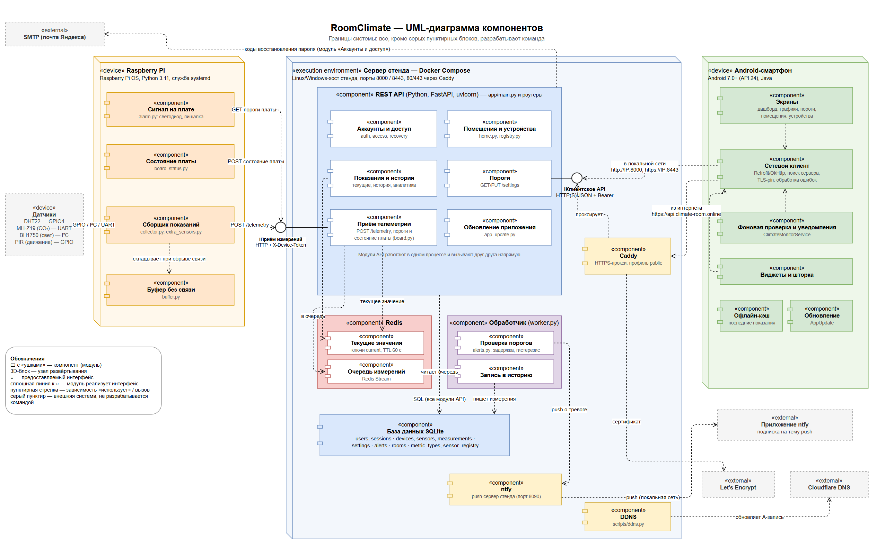

# Архитектура проекта

Материалы лабораторной работы № 3. Описание опирается на требования и границы MVP из
[requirements.md](requirements.md); идентификаторы `FR-…`, `US-…` — оттуда. Названия модулей
в тексте совпадают с подписями на диаграмме.

## 1. Общий подход и обоснование

**Тип архитектуры — клиент-серверная, с сервером в виде модульного монолита.** Система
состоит из трёх отдельно работающих программ на трёх узлах, которые общаются только по сети
через HTTP:

| Узел | Программа | Роль |
|---|---|---|
| Raspberry Pi | Сборщик (Python, служба systemd) | Клиент сбора: читает датчики и отправляет показания |
| Сервер стенда | REST API, обработчик, Redis, SQLite, ntfy в Docker Compose | Единственное место хранения, правил и проверки порогов |
| Android-смартфон | Приложение RoomClimate (Java) | Клиент представления: экраны, графики, уведомления |

Логически это три уровня: **представление** (Android), **приложение** (REST API и
обработчик — правила: доступ, пороги, тревоги, приём телеметрии), **данные** (SQLite —
история и настройки, Redis — текущие значения и очередь). Физически уровни приложения и
данных развёрнуты вместе на одном хосте в Docker Compose.

**Где что находится.** Пользовательское взаимодействие — только в Android-приложении.
Основные правила (кто какую плату видит, допустимость порогов, когда открыть тревогу,
какие показатели принимать) — только на сервере. Хранение — только на сервере. Плата не
хранит историю (кроме временного буфера на время обрыва связи) и не принимает решений,
кроме локального сигнала светодиодом по порогам, полученным с сервера.

**Что работает вместе, а что раздельно.** Модули REST API («Аккаунты и доступ», «Показания
и история», «Пороги», «Помещения и устройства», «Приём телеметрии», «Обновление
приложения») работают в одном процессе и вызывают друг друга напрямую — это модульный
монолит. Обработчик — отдельный процесс того же образа, связан с API через очередь Redis.
Плата и телефон — отдельные приложения; внешние системы: почтовый сервер (SMTP),
Let's Encrypt, Cloudflare DNS, приложение ntfy на телефоне.

**Почему так.**

- Сбор не зависит от телефона (FR-01): плата шлёт показания по расписанию, даже когда
  приложение закрыто, а сервер проверяет пороги и рассылает уведомления (FR-07) без участия
  телефона.
- Один сервер — одна точка истины для нескольких плат и телефонов (US-05, US-10).
  Добавление платы не требует переноса базы.
- GPIO доступен только на плате, экран — только на телефоне: ответственность разделена по
  тому, где физически находятся ресурсы.
- Монолит вместо микросервисов: пять человек, срок MVP — 1 декабря, нагрузка — одна запись
  в 10 с на плату и 1–2 телефона. Отдельные сервисы на каждый модуль дали бы больше
  развёртываний и сетевых стыков без выигрыша.
- Очередь между приёмом и записью: плата получает ответ сразу (значение уже в Redis и
  видно на дашборде), а медленная запись в SQLite и проверка порогов идут в обработчике.

**Ограничения и компромиссы.**

- Сервер — единая точка отказа: если стенд выключен, приложение показывает последние
  данные из офлайн-кэша, а плата копит показания в буфере (FR-10), но новых данных никто
  не видит.
- SQLite рассчитана на один хост; горизонтальное масштабирование не предусмотрено.
- Изменение любого модуля API выпускается пересборкой всего образа сервера.

**Состав MVP и развитие.** Для MVP (US-01–US-04, US-08) нужны: «Сборщик показаний»,
«Приём телеметрии», Redis, «Обработчик», SQLite, «Аккаунты и доступ», «Показания и
история», «Пороги», ntfy, в приложении — «Экраны», «Сетевой клиент», «Фоновая проверка и
уведомления». Остальные модули — развитие после ядра: «Помещения и устройства» (US-05–US-07),
«Буфер без связи» (US-09), «Сигнал на плате», «Состояние платы», «Виджеты и шторка»,
«Офлайн-кэш», «Обновление приложения», Caddy и DDNS (доступ из интернета).

## 2. Схема архитектуры

*Рисунок 1 — UML-диаграмма компонентов RoomClimate.*

Нотация — UML 2, диаграмма компонентов с узлами развёртывания. Обозначения приведены на
самой схеме: прямоугольник с «ушками» — компонент, 3D-блок — узел, кружок — предоставляемый
интерфейс, сплошная линия к кружку — компонент реализует интерфейс, пунктирная стрелка —
зависимость (использует / вызывает) с подписью о назначении, серые пунктирные блоки —
внешние системы.

**Редактируемые файлы:**
[`architecture/roomclimate-components.drawio`](architecture/roomclimate-components.drawio)
и [`architecture/roomclimate-components.drawio.png`](architecture/roomclimate-components.drawio.png)
(PNG со встроенной копией диаграммы). Открываются в редакторе **draw.io / diagrams.net**
(онлайн app.diagrams.net или настольное приложение): «Файл → Открыть» — элементы, подписи
и связи доступны как отдельные объекты.

## 3. Модули и их функции

### Плата Raspberry Pi

| Модуль | Назначение и функции | Границы ответственности | Данные | Взаимодействие |
|---|---|---|---|---|
| Сборщик показаний | Раз в 10 с читает DHT22, при наличии — MH-Z19 (CO₂), BH1750 (свет), PIR (движение); повторяет неудачное чтение до 5 раз, отбрасывает неправдоподобные значения; сам находит подключённые доп. датчики. | Не хранит историю, не проверяет пороги для уведомлений. | Показания «тип — значение — единица», идентификатор платы, токен устройства. | Отправляет пакет на «Приём телеметрии» через IПриём измерений; при ошибке связи отдаёт показания «Буферу без связи». |
| Буфер без связи | Хранит показания на диске на время обрыва (до 20 000), досылает порциями по 30 со временем замера. | Не решает, что делать с данными на сервере. | Файл `buffer.jsonl`. | Используется сборщиком. |
| Сигнал на плате | Включает светодиод и пищалку, если показание вне порогов. | Только локальный сигнал, уведомления на телефон не шлёт. | Пороги платы (кэш). | Раз в 5 минут читает пороги платы через IПриём измерений. |
| Состояние платы | Раз в 60 с собирает температуру процессора, сеть Wi-Fi и уровень сигнала, IP, время работы, версию сборщика, размер буфера, подключённые датчики. | Только диагностика. | Сведения о плате. | Отправляет их через IПриём измерений; приложение показывает их в «Устройствах». |

### Сервер

| Модуль | Назначение и функции | Границы ответственности | Данные | Взаимодействие |
|---|---|---|---|---|
| Приём телеметрии | Принимает пакет показаний: проверяет токен устройства, известность показателя (неизвестный → 422), конечность чисел и время замера (досланное не старше недели). Отдаёт плате её пороги, принимает состояние платы. | Не пишет в SQLite сам и не проверяет пороги для тревог. | Пакет показаний, время замера, признак «досланное». | Кладёт текущее значение в «Текущие значения» и измерение в «Очередь измерений» (Redis). |
| Аккаунты и доступ | Регистрация, вход, сессии (Bearer-токен), ограничение попыток входа, восстановление пароля по коду из письма, проверка доступа пользователя к плате (владелец / участник). | Не хранит показания. | Пользователи, хэши паролей (PBKDF2), сессии, коды восстановления. | Вызывается всеми модулями клиентского API напрямую; отправляет письма через SMTP. |
| Показания и история | Текущие значения платы (из Redis, при их отсутствии — последние из SQLite), история за период со сжатием до заданного числа точек, аналитика (точка росы, риск плесени), выгрузка CSV. | Не принимает данные от платы. | Измерения. | Читает Redis и SQLite; проверяет доступ через «Аккаунты и доступ». |
| Пороги | Чтение и сохранение порогов температуры и влажности платы; проверка `min < max` и допустимых диапазонов. | Не проверяет сами показания на выход за пороги (это делает обработчик). | Настройки порогов платы. | Читает и пишет SQLite; пороги используют «Проверка порогов» и «Приём телеметрии» (для платы). |
| Помещения и устройства | Помещения пользователя, привязка платы и датчиков из справочника, семейный доступ, профиль, журнал тревог. | Не работает с показаниями напрямую. | Помещения, справочники показателей и датчиков, участники доступа. | SQLite; доступ — через «Аккаунты и доступ». |
| Обновление приложения | Отдаёт сведения о последней версии и APK, принимает новую версию из CI по токену. | Не собирает APK. | Метаданные версии, файл APK. | Используется модулем «Обновление» в приложении и пайплайном CI. |
| Redis: Текущие значения | Последнее значение каждого показателя платы с временем жизни 60 с. | Не история. | Ключи `current`. | Пишет «Приём телеметрии», читает «Показания и история». |
| Redis: Очередь измерений | Буфер между приёмом и записью (Redis Stream). | Не долговременное хранение. | Сообщения с измерениями. | Пишет «Приём телеметрии», читает «Обработчик». |
| Обработчик: Запись в историю | Забирает измерения из очереди, создаёт при необходимости плату и датчик, записывает измерение. | Не отвечает клиентам. | Измерения. | Redis → SQLite. |
| Обработчик: Проверка порогов | Сравнивает измерение с порогами платы с задержкой 60 с и гистерезисом, открывает и закрывает тревоги, отмечает «датчик молчит». Досланные показания пропускает. | Не изменяет пороги. | Тревоги, состояние проверки. | SQLite; отправляет push через ntfy. |
| База данных SQLite | Долговременное хранение: пользователи и сессии; платы, датчики, измерения; пороги; тревоги; помещения; справочники. Миграции применяются при старте. | Не содержит логики. | Файл в томе Docker. | Используется модулями API и обработчиком. |
| ntfy | Push-сервер стенда без Google-сервисов. | Не формирует текст уведомлений. | Сообщения в теме push. | Получает сообщения от «Проверки порогов», доставляет приложению ntfy на телефоне. |
| Caddy, DDNS | Caddy — HTTPS с сертификатом Let's Encrypt для доступа из интернета; DDNS — обновляет A-запись в Cloudflare при смене IP. | Не содержат логики продукта. | Сертификаты, IP-адрес. | Caddy проксирует запросы на IКлиентское API. |

### Android-приложение

| Модуль | Назначение и функции | Границы ответственности | Данные | Взаимодействие |
|---|---|---|---|---|
| Экраны | Вход и регистрация, дашборд текущих показаний, графики за период, настройка порогов, помещения, устройства, профиль, семья. | Не хранит историю как основное хранилище, не обращается к датчикам. | Отображаемые значения, ввод пользователя. | Получает и отправляет данные только через «Сетевой клиент». |
| Сетевой клиент | Описание запросов к API (Retrofit), поиск сервера (локальная сеть / сохранённый адрес / интернет-адрес), проверка сертификата стенда (TLS-pin), перевод ошибок в понятные сообщения. | Не содержит логики экранов. | Токен сессии, адрес сервера. | Вызывает IКлиентское API напрямую в локальной сети или через Caddy из интернета. |
| Фоновая проверка и уведомления | Служба периодически запрашивает текущие показания и пороги, показывает уведомление при выходе за порог. | Дублирует серверные push, если ntfy недоступен. | Последние значения и пороги. | Через «Сетевой клиент». |
| Виджеты и шторка | Показатели на рабочем столе и в карточке шторки. | Только отображение. | Последние значения. | Через «Сетевой клиент». |
| Офлайн-кэш | Последние полученные показания на случай недоступности сервера. | Не источник истины. | Кэш в настройках приложения. | Используется экранами. |
| Обновление | Проверяет новую версию на сервере, скачивает APK, сверяет SHA-256. | Установку подтверждает пользователь. | Версия, файл APK. | Модуль «Обновление приложения» сервера. |

**Почему функции объединены так.** Правила, которые должны быть одинаковы для всех клиентов
(доступ, пороги, тревоги), собраны на сервере, поэтому телефоны и платы не дублируют их
(высокая связность внутри модулей, низкая связанность между узлами). Модули API разделены
по предметным сущностям (аккаунт, показания, пороги, помещения), а приём телеметрии отделён
от клиентского API, потому что у них разные клиенты, способ авторизации и нагрузка.

## 4. Связи и интерфейсы

Сервер предоставляет два интерфейса:

- **IПриём измерений** — для плат: HTTP, JSON, авторизация токеном устройства
  (`X-Device-Token`).
- **IКлиентское API** — для приложения: HTTP(S), JSON, авторизация Bearer-токеном сессии.
  Контракт ядра MVP оформлен в OpenAPI — [api.md](api.md), [api/openapi.yaml](api/openapi.yaml).

| Откуда → куда | Назначение | Способ | Информация и результат |
|---|---|---|---|
| Сборщик показаний → Приём телеметрии | Передать новые показания | HTTP POST через IПриём измерений | Плата передаёт идентификатор и список показаний (и время замера, если досылает). Сервер проверяет их, сохраняет текущее значение и ставит измерение в очередь, отвечает списком принятых. На неизвестный показатель отвечает ошибкой — сборщик убирает его и повторяет отправку остальных. |
| Сборщик показаний → Буфер без связи | Не потерять данные при обрыве | Вызов внутри программы | Если сервер не ответил, показание записывается в буфер; после восстановления связи буфер досылается. |
| Сигнал на плате → Приём телеметрии | Узнать пороги для светодиода | HTTP GET через IПриём измерений | Плата получает пороги своей платы и при выходе показаний за них включает светодиод. |
| Приём телеметрии → Redis | Быстро показать новое значение и отложить запись | Команды Redis | Текущее значение заменяет предыдущее; измерение добавляется в очередь. |
| Обработчик → Redis, SQLite | Записать историю и проверить пороги | Чтение очереди, SQL | Обработчик забирает измерение, записывает его в историю, сравнивает с порогами; при устойчивом нарушении открывает тревогу. |
| Проверка порогов → ntfy | Сообщить пользователю о тревоге | HTTP | Передаётся заголовок и текст: плата, показатель, значение, порог. ntfy доставляет сообщение подписанным телефонам. |
| Сетевой клиент → Аккаунты и доступ | Войти и получить сессию | HTTPS/HTTP через IКлиентское API | Приложение передаёт email и пароль, получает токен; далее передаёт его в каждом запросе. Неверный токен → «войдите заново». |
| Сетевой клиент → Показания и история | Показать дашборд и график | IКлиентское API | Приложение запрашивает текущие значения платы или историю за период; сервер проверяет доступ и возвращает значения со временем измерения либо «нет данных». |
| Сетевой клиент → Пороги | Сохранить диапазон уведомлений | IКлиентское API | Приложение передаёт минимум и максимум; сервер проверяет `min < max`, сохраняет и возвращает сохранённые значения либо понятную ошибку — экран показывает её, не меняя сохранённых значений. |
| Модули API → Аккаунты и доступ | Проверить пользователя и права на плату | Прямой вызов функции | По токену определяется пользователь; по плате — является ли он владельцем или участником. |
| Модули API → SQLite | Прочитать и сохранить данные | SQL | Пользователи, пороги, помещения, история. |
| Caddy → IКлиентское API | Доступ из интернета | HTTPS → HTTP внутри Docker | Caddy принимает HTTPS на 443 и передаёт запрос API, сохраняя реальный IP клиента. |

**Сценарий «уведомление о жаре» через модули.** Сборщик отправляет 27,1 °C → «Приём
телеметрии» кладёт значение в Redis и очередь → дашборд, запросив «Показания и историю»,
сразу видит 27,1 °C → «Обработчик» записывает измерение в SQLite, «Проверка порогов»
сравнивает с порогом 26 °C; через 60 с устойчивого нарушения открывает тревогу и отправляет
сообщение в ntfy → телефон показывает уведомление.

## 5. Технологии и инструменты

| Технология | Где и для чего | Почему подходит | Ограничения |
|---|---|---|---|
| Python 3.11 | Сборщик на плате и сервер | На Raspberry Pi OS Python установлен, для DHT22 и I²C/UART есть готовые библиотеки Adafruit; один язык на плате и сервере — общие навыки в команде. | Медленнее компилируемых языков — для нашей нагрузки несущественно; на Pi нужен venv для библиотек. |
| FastAPI + uvicorn | REST API | Проверка входных данных через pydantic-схемы, автоматическая OpenAPI-документация (`/docs`), мало кода на эндпоинт — важно до срока MVP. | Ошибки pydantic по умолчанию на английском — переводятся модулем `errors.py`. |
| SQLite | Долговременное хранение | Реляционные связи «плата — датчик — измерение», выборки по времени и типу; один файл в томе Docker без отдельного сервера СУБД; транзакции и внешние ключи. | Один пишущий процесс и один хост; при росте — перенос схемы на PostgreSQL без смены модели. |
| Redis | Текущие значения и очередь | Значение доступно дашборду сразу после приёма; очередь (Stream) развязывает приём и запись; ограничение попыток входа. | Ещё один контейнер; при недоступном Redis приём и текущие значения отвечают 503; если текущих значений в Redis нет (истёк TTL), они берутся из SQLite. |
| Docker Compose | Развёртывание сервера | Одинаковый запуск у всех участников и на стенде одной командой; тот же стек поднимается в CI для смоук-теста. | Нужен Docker Desktop на Windows-стенде; стенд стартует после входа пользователя в Windows. |
| Java, Android SDK (minSdk 24) | Приложение | Требование дисциплины и опыт команды в Java; Android 7.0+ покрывает телефоны участников. | Больше шаблонного кода, чем на Kotlin. |
| Retrofit, OkHttp, Gson | Сетевой клиент | Описание API интерфейсом Java, разбор JSON в модели, перехват ошибок; OkHttp позволяет проверить сертификат стенда (TLS-pin). | Модели нужно вручную синхронизировать с контрактом (`openapi.yaml`). |
| ntfy (свой сервер) | Push-уведомления | Работает в локальной сети без Google Firebase и без аккаунтов. | На телефоне нужно приложение ntfy и подписка на тему; без связи со стендом — только фоновая проверка приложения. |
| Caddy, Let's Encrypt, Cloudflare DNS | Доступ из интернета | Автоматический HTTPS-сертификат; DDNS переживает смену IP провайдером. | Нужны домен и проброс портов 80/443 на роутере; вне MVP. |
| GitHub, GitHub Actions | Хранение кода, PR, CI | Репозиторий команды уже на GitHub; Actions бесплатно запускают тесты на каждый PR. | Время сборки Android ≈ 5–8 мин. |
| draw.io | Диаграммы архитектуры | Бесплатный, хранит редактируемый файл в репозитории. | — |
