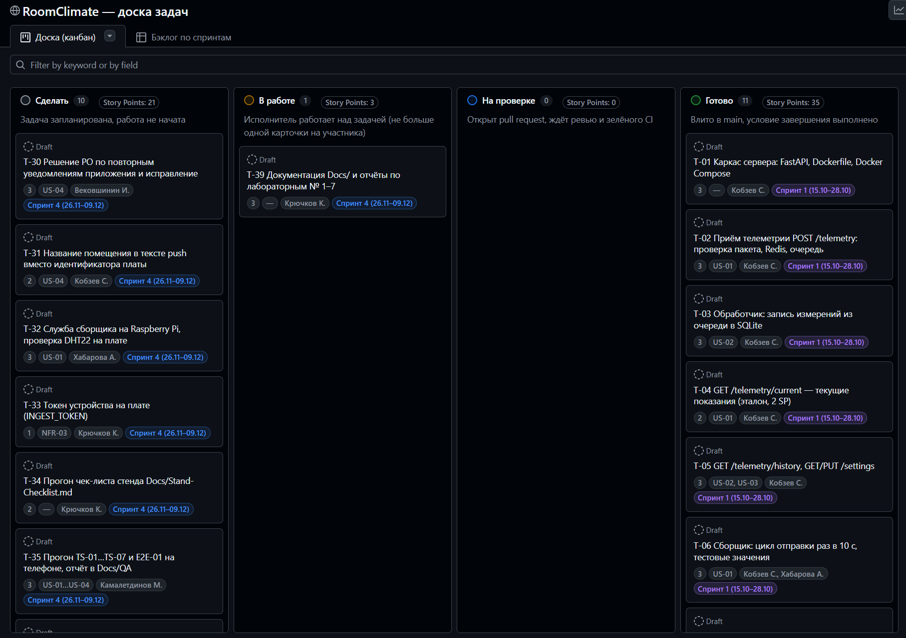

# Планирование: бэклог, спринты, доска задач

Материалы лабораторной работы № 4. Истории и приоритеты — из [requirements.md](requirements.md),
модули — из [architecture.md](architecture.md).

**Доска задач:** https://github.com/users/shmim385/projects/1 (GitHub Projects, канбан-колонки
«Сделать» → «В работе» → «На проверке» → «Готово»). Правило команды: **нет карточки — нет задачи**.

Длина спринта — 2 недели. Спринты: 1 — 15.10–28.10, 2 — 29.10–11.11, 3 — 12.11–25.11,
4 — 26.11–09.12.2026 (текущий, последний перед сдачей MVP).

## 1. Бэклог продукта

Упорядочен по приоритету: сверху ядро MVP (Must) и технические задачи, без которых его не
собрать; ниже — Should и Could. Статус — на 26.11.2026.

| № | Элемент бэклога | Тип | MoSCoW | Модули | Статус |
|---|---|---|---|---|---|
| 1 | Каркас сервера, Docker Compose, стенд в Wi-Fi | техн. | Must | REST API, Redis, SQLite | Готово (Спринты 1, 3) |
| 2 | Контракт приёма показаний (IПриём измерений) и сборщик | техн. | Must | Приём телеметрии, Сборщик | Готово (Спринт 1) |
| 3 | US-08. Личный аккаунт | история | Must | Аккаунты и доступ, Экраны | Готово (Спринты 1–2) |
| 4 | US-01. Текущие показатели | история | Must | Сборщик, Приём телеметрии, Показания и история, Экраны | Готово (Спринт 2) |
| 5 | US-03. Диапазон уведомлений | история | Must | Пороги, Экраны | Готово (Спринт 2) |
| 6 | US-04. Уведомление о выходе за диапазон | история | Must | Проверка порогов, ntfy, Фоновая проверка | Готово (Спринты 2–3), открыт вопрос AC-04.3 |
| 7 | US-02. График за сутки | история | Must | Показания и история, Экраны | Готово (Спринт 2) |
| 8 | CI: сборка и тесты на каждый pull request | техн. | Must | все | Готово (Спринты 2–3) |
| 9 | US-05. Список помещений | история | Should | Помещения и устройства | Готово (Спринт 3) |
| 10 | US-06. Детали помещения | история | Should | Помещения и устройства, Экраны | Готово (Спринт 3) |
| 11 | US-07. Пороги для каждого помещения | история | Should | Пороги | Готово (Спринт 3) |
| 12 | US-09. Показания без пропусков | история | Should | Буфер без связи, Приём телеметрии | Готово (Спринт 3) |
| 13 | US-10. Общий доступ | история | Should | Аккаунты и доступ | Готово (Спринт 3) |
| 14 | US-11. Выгрузка CSV | история | Could | Показания и история | Готово (Спринт 3) |
| 15 | Виджеты, доп. датчики, подсказки, сигнал на плате, обновление приложения | возможности | Could | разные | Готово (Спринт 3), на плате не проверено |
| 16 | Задачи Спринта 4 (раздел 4) | — | — | — | Сделать |

## 2. Спринт 1 (15.10–28.10.2026)

### Цель спринта

> **К концу спринта плата отправляет показания на сервер, сервер их хранит, а пользователь
> входит в приложение и видит на телефоне текущие температуру и влажность (US-08, US-01).**

### Оценка: шкала и эталон

- Шкала story points: **1, 2, 3, 5, 8, 13** (задача больше 13 дробится).
- **Эталон — T-04** «GET /telemetry/current»: небольшой, всем понятный эндпоинт чтения — **2 SP**.
- Остальные задачи оцениваются сравнением с эталоном «покером планирования»: участники
  одновременно называют оценку, при расхождении обсуждают причину. Пример такого случая —
  T-07: оценка «3» учитывает только код чтения, «8» — ещё подключение датчика, подтягивающий
  резистор и нестабильные чтения DHT22; после обсуждения задача получает 5.

> Спринт 1 команда вела без доски и без оценок в story points: состав задач и сроки
> восстановлены по договорённостям в README и истории коммитов, оценки проставлены при
> оформлении этой лабораторной по методике выше. Начиная со Спринта 4 планирование ведётся
> на доске до начала работы.

### Задачи спринта

| ID | Задача | История | Исполнитель | SP | Условие завершения | Зависимости |
|---|---|---|---|---|---|---|
| T-01 | Каркас сервера: FastAPI, Dockerfile, Docker Compose (api, redis, worker) | — | Кобзев С. | 3 | `docker compose up` поднимает стек, `GET /health` → `ok` | — |
| T-02 | Приём телеметрии `POST /telemetry`: проверка пакета, текущее значение в Redis, очередь | US-01 | Кобзев С. | 3 | `smoke_test.py` отправляет пакет и получает 200 | T-01 |
| T-03 | Обработчик: запись измерений из очереди в SQLite (devices, sensors, measurements) | US-02 | Кобзев С. | 3 | После отправки пакета измерение есть в таблице measurements | T-02 |
| T-04 | `GET /telemetry/current` — текущие показания платы (**эталон**) | US-01 | Кобзев С. | 2 | Возвращает последнее значение каждого показателя | T-02 |
| T-05 | `GET /telemetry/history`, `GET/PUT /settings` | US-02, US-03 | Кобзев С. | 3 | `smoke_test.py` проходит все шаги | T-03 |
| T-06 | Сборщик: цикл отправки раз в 10 с, тестовые значения без платы | US-01 | Кобзев С., Хабарова А. | 3 | На ПК сборщик шлёт пакеты, сервер отвечает 200 | T-02 |
| T-07 | Сборщик: чтение DHT22 через GPIO с повторами и фильтром неправдоподобных значений | US-01 | Хабарова А. | 5 | На плате значения DHT22 видны в `/telemetry/current` | T-06, плата и датчик |
| T-08 | Стенд: сервер в Docker на ПК, доступ из Wi-Fi для платы и телефона | US-01 | Крючков К. | 3 | С телефона в той же Wi-Fi открывается `http://IP:8000/health` | T-01 |
| T-09 | Android: экраны входа, регистрации и аккаунта | US-08 | Вековшинин И. | 3 | Экраны открываются, пустые поля и короткий пароль отклоняются | — |
| T-10 | Android: структура пакетов (ui, network, models, notify), интерфейс API на Retrofit | US-01 | Вековшинин И. | 2 | Проект собирается, `ApiService` описывает запросы показаний | T-04 (контракт) |
| T-11 | Android: дашборд текущих значений с запросом к серверу и обработкой ошибок | US-01 | Камалетдинов М., Вековшинин И. | 5 | На телефоне видны значения с сервера; без связи — сообщение об ошибке | T-10, T-08 |

**Плановый объём: 35 SP.** Для первого спринта скорость команды ещё неизвестна, поэтому
план сравнивается с фактом ниже — это и даёт скорость для следующих спринтов.

### Итог спринта (план — факт)

Факт определён по истории коммитов `main`.

| ID | SP | Факт |
|---|---|---|
| T-01…T-06 | 17 | Готово 15.10 (коммит `fac61fa`: сервер, сборщик, `smoke_test.py`) |
| T-09 | 3 | Готово 22.10 |
| T-10 | 2 | Готово 23.10 |
| T-07 | 5 | Не завершено → Спринт 3 (чтение DHT22 готово 15.11) |
| T-08 | 3 | Не завершено → Спринт 3 (стенд и `start.ps1` — 12.11) |
| T-11 | 5 | Не завершено → Спринт 2 (интеграция и дашборд — 31.10) |

**Скорость (velocity) Спринта 1: 22 SP из 35 запланированных.** Цель достигнута частично:
плата (пока с тестовыми значениями) отправляет показания, сервер их хранит, вход в приложение
есть, но экран с данными сервера появился только во втором спринте. Вывод для следующих
спринтов: брать задачи на ~22–25 SP и не планировать задачи, зависящие от железа (плата,
стенд), без подтверждённого доступа к нему.

### Спринты 2 и 3 (кратко)

- **Спринт 2 (29.10–11.11):** интеграция приложения с сервером и регистрация (31.10), дашборд,
  пороги, история, уведомления (31.10–07.11), CI сервера (31.10), графики с выбором периода (11.11).
- **Спринт 3 (12.11–25.11):** безопасность и русские ошибки, стенд и автозапуск, HTTPS и доступ
  из интернета, помещения и общий доступ, офлайн-режим, виджеты, DHT22 и доп. датчики, буфер
  без связи, справочник плат и датчиков, обновление приложения (PR #8–#23).

## 3. Доска задач

*Рисунок — доска задач в GitHub Projects (вид «Доска»).*

На доске колонки **Сделать / В работе / На проверке / Готово**, поля карточки: исполнитель,
оценка (SP), связанная история, спринт. Карточки Спринта 1 находятся в «Готово» (перенесённые
задачи закрыты в Спринтах 2–3), карточки текущего Спринта 4 в начале спринта — в «Сделать».
Ограничение незавершённой работы: в «В работе» — не больше одной карточки на участника.

## 4. Спринт 4 (26.11–09.12.2026, текущий)

> **Цель: к концу спринта пользователь проходит сценарий демонстрации E2E-01 на телефоне со
> стендом и настоящей платой без замечаний, а материалы проекта готовы к сдаче.**

| ID | Задача | История | Исполнитель | SP | Условие завершения | Зависимости |
|---|---|---|---|---|---|---|
| T-30 | Решение PO по повторным уведомлениям приложения и исправление | US-04 | Вековшинин И. | 3 | На телефоне выполняется AC-04.3 | — |
| T-31 | Название помещения в тексте push вместо идентификатора платы | US-04 | Кобзев С. | 2 | Уведомление «Спальня: …»; тест обновлён | — |
| T-32 | Установка службы сборщика на Raspberry Pi и проверка DHT22 на плате | US-01 | Хабарова А. | 3 | После перезагрузки Pi показания идут на стенд | — |
| T-33 | Токен устройства на плате (INGEST_TOKEN) | NFR-03 | Крючков К. | 1 | Без токена 401, плата с токеном принимается | T-32 |
| T-34 | Прогон чек-листа стенда `Docs/Stand-Checklist.md` | — | Крючков К. | 2 | Все пункты отмечены, замечания — карточками | — |
| T-35 | Прогон TS-01…TS-07 и E2E-01 на телефоне, отчёт в `Docs/QA` | US-01…US-04 | Камалетдинов М. | 3 | Отчёт в репозитории, ошибки — карточками | T-30…T-33 |
| T-36 | Секреты подписи релиза в GitHub, проверка `release-apk` | — | Кобзев С. | 2 | `release-apk` собирает подписанный APK | — |
| T-37 | Защита ветки `main`: зелёный CI + одобрение ревьюера | — | Кобзев С. | 1 | PR с красным CI нельзя влить | — |
| T-38 | Влить PR с поиском сервера на эмуляторе и автопубликацией APK | — | Крючков К. | 2 | PR влит, CI зелёный | T-36 |
| T-39 | Документация `Docs/` и отчёты по лабораторным № 1–7 | — | Крючков К. | 3 | Отчёты в `Docs/Reports`, PR влит | — |
| T-40 | Демонстрация MVP преподавателю | US-01…US-04 | Вековшинин И. | 2 | Демонстрация проведена, замечания записаны | T-35 |

**Плановый объём Спринта 4: 24 SP** — в пределах скорости первого спринта (22 SP) с учётом того,
что половина задач — проверки и настройка, а не новая разработка.
